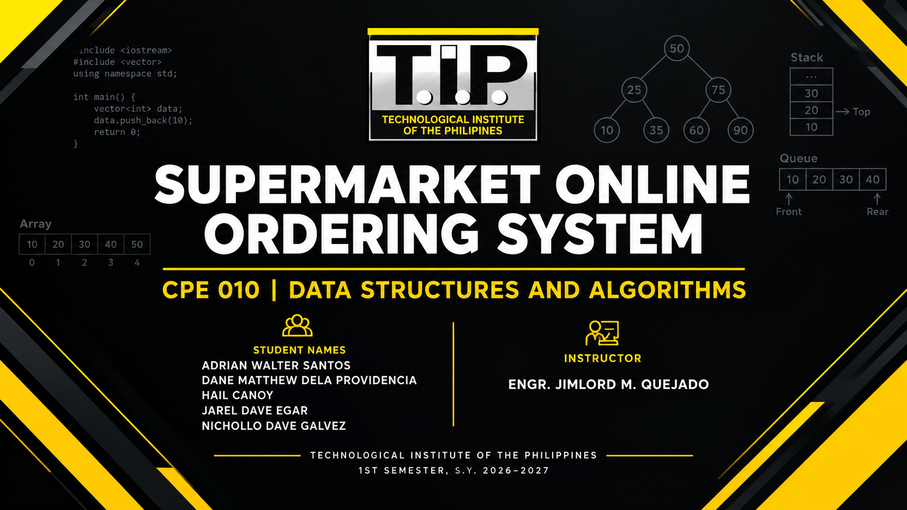

  

# 🛒 Supermarket Online Ordering System

**Course:** CPE 010 – Data Structures and Algorithms  
**Section:** CPE21S1 – Group 3  
**Instructor:** Engr. Jimlord M. Quejado  
**Submission Date:** November 5, 2026

## 📌 Project Description

The **Supermarket Online Ordering System** is a C++ project that simulates the process of ordering products from a supermarket. It aims to organize supermarket ordering tasks and demonstrate how data structures and algorithms can be applied to a real-world business process.

This project is developed as part of the requirements for CPE 010 – Data Structures and Algorithms. It focuses on applying programming concepts to manage information, process orders, and improve the organization and efficiency of supermarket operations.

## 🎯 Objectives

- Develop a C++ program that simulates a supermarket online ordering process.
- Apply appropriate data structures and algorithms to manage product and order information.
- Organize and process data efficiently.
- Analyze the time and space complexity of selected operations.
- Practice writing structured and readable C++ code.

## ⚙️ Technologies Used

- **Programming Language:** C++
- **Development Environment:** Visual Studio Code
  
## ✨ System Features

The system's features depend on the functions implemented in the source code. The intended supermarket ordering functions may include:

- Viewing available supermarket products
- Selecting products for an order
- Managing customer orders
- Displaying order summaries
- Searching for product or order information

## 🧠 Data Structures and Algorithms

The project is intended to demonstrate the use of data structures and algorithms discussed in class. Depending on the final implementation, these may include:

- Arrays or linked lists for storing product information
- Queues for processing orders
- Searching algorithms for locating records
- Sorting algorithms for organizing product or order information
- Other suitable data structures and algorithms required by the system

## 👥 Group Members

1. Adrian Walter Santos
2. Dane Matthew Dela Providencia
3. Hail Canoy
4. Jarel Dave Egar
5. Nichollo Dave Galvez

## 👨‍🏫 Instructor

Engr. Jimlord M. Quejado

## 📚 Academic Purpose

This project is created for educational purposes as part of the requirements for CPE 010 – Data Structures and Algorithms. It demonstrates the application of C++ programming, data structures, algorithm design, and performance analysis in a simulated supermarket ordering system.

---

**Developed by CPE21S1 – Group 3**
